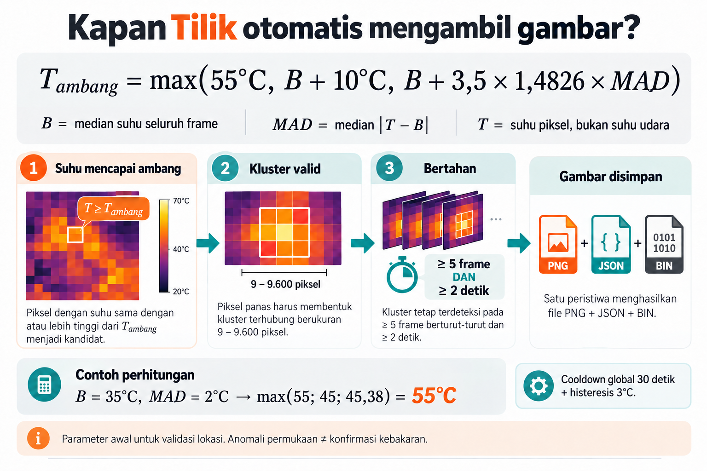

# Tilik — audit aturan auto-capture thermal TPA

Tanggal: 27 Oktober 2026. Status: aturan screening awal, belum tervalidasi lapangan.
Implementasi: `hotspot/engine.py`; konfigurasi awal: `config/landfill.json`.

## Ringkasan untuk product, developer, dan QA

Tilik menyimpan bukti **anomali suhu permukaan**. Ini bukan alat untuk menetapkan
bahwa sampah pasti terbakar, menyatakan lokasi aman, atau mengukur suhu bagian
bawah timbunan. Panas permukaan dipengaruhi matahari, material, mesin, pantulan,
jarak, dan cuaca. Data gas, inspeksi lapangan, dan pengukuran lain diperlukan
untuk penilaian kejadian yang sebenarnya [1][2].

Tidak ada sumber yang diaudit di sini yang menetapkan kombinasi 55°C, 10°C,
3,5 MAD, 9 piksel dan 2 detik sebagai standar universal TPA. Angka tersebut
adalah **parameter awal milik proyek**. Jangan menyebut rumus ini sebagai
ketentuan Permen PUPR atau batas legal tanpa pasal dan metode ukur yang relevan.
Angka EPA untuk temperatur gas/internal tidak boleh langsung dipindahkan
menjadi ambang kamera permukaan [1].



## Rumus yang dipakai

### 1. Ubah piksel mentah menjadi suhu

```text
T_i = raw_i / 100 − 273,15  [°C]
```

Berlaku HANYA jika output kamera sudah dipastikan radiometrik TLinear 0,01 K,
AGC tidak diterapkan pada jalur raw, telemetry tidak ikut menjadi piksel,
160 × 120, uint16 little-endian. Y16 saja belum membuktikan mode tersebut.
Warna PNG bukan sumber perhitungan suhu. TLinear, gain, FFC, emisivitas,
jarak, dan keadaan sensor perlu dicatat/diverifikasi saat commissioning [4].
Resolusi 0,01 K tidak berarti akurasi pengukuran 0,01°C.

### 2. Hitung kondisi latar frame

```text
B   = median(T_1, T_2, …, T_19200)
MAD = median(|T_1 − B|, |T_2 − B|, …, |T_19200 − B|)
S   = 1,4826 × MAD
```

- **T_i**: suhu piksel ke-i; bukan suhu udara.
- **B**: nilai tengah suhu seluruh frame, sebagai perkiraan latar.
- **MAD**: nilai tengah jarak absolut setiap suhu terhadap B; mengukur sebaran.
- **1,4826**: faktor statistik, kira-kira 1 / 0,67449. Pada distribusi normal,
  hasilnya mendekati simpangan baku. Ini bukan angka khusus TPA atau kamera [3].
- **3,5**: pilihan sensitivitas proyek, dapat diubah; bukan probabilitas
  kebakaran atau jaminan tingkat false-positive pada citra yang saling berkorelasi.

Saat ini B dihitung dari seluruh frame, bukan ROI tanah atau cincin lokal.
Ini mengasumsikan scene masih cukup mewakili latar. Jika area panas mendominasi,
B ikut naik dan objek panas bisa tidak lolos. ROI dan baseline temporal belum
tersedia; jangan menggambarkannya sebagai fitur yang sudah diimplementasikan.

### 3. Pilih ambang terbesar

```text
A = max(T_abs, B + Δ, B + k × 1,4826 × MAD)

Default:
A = max(55°C, B + 10°C, B + 3,5 × 1,4826 × MAD)
```

Piksel menjadi kandidat jika **T_i ≥ A**. `max` berarti ambil nilai paling besar.
Ketiga syarat harus terpenuhi bersama: cukup panas secara absolut, cukup berbeda
dari latar, dan cukup menonjol dibanding variasi scene.

| Contoh ilustrasi | B | MAD | Tiga calon ambang | Ambang A |
|---|---:|---:|---|---:|
| Latar relatif sejuk | 35°C | 2°C | 55; 45; 45,3782 | 55°C |
| Latar panas | 48°C | 2°C | 55; 58; 58,3782 | 58,3782°C |
| Scene sangat bervariasi | 40°C | 5°C | 55; 50; 65,9455 | 65,9455°C |
| Seluruh frame 70°C | 70°C | 0°C | 55; 80; 70 | 80°C: tidak ada kandidat |

Perbandingan di kode memakai nilai penuh; pembulatan di UI/JSON hanya tampilan.
Contoh terakhir adalah **keterbatasan yang diketahui**, bukan hasil 'aman'.
Jalur peringatan overheating seluruh scene perlu dirancang terpisah; jangan
menghapus syarat kontras secara diam-diam.

### 4. Kelompokkan piksel dan verifikasi durasi

Piksel kandidat yang bersentuhan sisi ATAU diagonal digabung dengan 8-connected
component labeling. Setiap komponen C adalah satu kluster kandidat.

```text
valid(C) = 9 ≤ jumlah_piksel(C) ≤ 9.600
persisten(C) = frame_berurutan(C) ≥ 5 DAN durasi(C) ≥ 2 detik
capture = frame_valid DAN ada C valid & persisten DAN state siap merekam
```

9 piksel bukan harus kotak 3 × 3, dan bukan selalu luas tanah yang sama. Ukuran
fisiknya berubah dengan ketinggian, lensa, sudut, dan medan. Perkiraan untuk kamera
nadir dan tanah datar adalah `GSD_x ≈ 2 H tan(HFOV/2) / 160`; luas cluster kira-kira
`n × GSD_x × GSD_y`, dengan HFOV/VFOV dan tinggi di atas tanah yang benar.
Ini perkiraan geometrik, bukan akurasi terjamin atau koordinat hotspot.

Pada 9 fps ideal, 5 frame membentang sekitar 0,44 detik dari frame pertama.
Syarat 2 detik tetap harus tercapai; pada frame yang benar-benar kontinu,
sekitar 19 frame membentang 2 detik. Gunakan timestamp monotonic, bukan asumsi fps.
Gap frame >2 detik atau waktu mundur mereset persistence. Warmup live 10 detik
pada launcher bukan bukti sensor sudah stabil secara radiometrik.

## Hasil audit dan perubahan kode

| Bagian | Temuan | Tindakan |
|---|---|---|
| Statistik median/MAD | Sesuai definisi; asumsi scene perlu dinyatakan | Rumus dipertahankan; arti dan batas dijelaskan |
| Multi-hotspot | Penghitung temporal lama tidak independen; kluster baru dapat ikut tersimpan saat kluster lama memicu | **Diperbaiki:** track per kluster, one-to-one IoU; auto-capture hanya mencantumkan kluster yang sudah lolos persistence |
| File bukti | Raw 38.400 byte, PNG anotasi dan JSON dipublikasi secara atomik | Dipertahankan; metadata ditambah versi aturan/persistence |
| Cooldown | Global, bukan per lokasi | **Belum diubah:** 30 detik DAN pendinginan di bawah ambang saat trigger −3°C sebelum siap lagi |
| Luas maksimum | Kandidat >9.600 piksel dibuang | Bukan bukti sensor flare atau lokasi aman; dapat menyembunyikan kejadian luas |
| Baseline | Seluruh frame, tanpa ROI | Risiko scene campuran/dominasi panas dicatat |

Pencocokan IoU memakai irisan kotak pada frame berturutan; kecocokan dipilih dari
IoU terbesar dan setiap track hanya dipakai satu kali. Ini **bukan tracking
koordinat bumi**. Pergeseran drone, split/merge, occlusion dan pergantian objek pada
piksel yang sama masih bisa mengacaukan identitas. Piksel raw yang baru tetap ada
di BIN; PNG/JSON auto-capture hanya memberi anotasi kluster yang sudah matang.
Manual capture terpisah dan tidak membuktikan rule otomatis berhasil.

## Penting untuk drone bergerak

Default sekarang lebih cocok untuk bench/hover yang stabil daripada pemetaan
kontinu cepat. Jika `L` adalah panjang target yang tampak sepanjang lintasan dan
`v` kecepatan relatif, waktu terlihat kira-kira `L/v`. Persistence harus lebih
pendek daripada waktu itu, dan pencocokan antarframe juga harus tetap berhasil.

Cooldown global bisa melewatkan hotspot baru selama ≥30 detik, bahkan lebih lama
jika scene tidak pernah turun di bawah batas rearm. Jangan mengklaim semua hotspot
sepanjang penerbangan pasti direkam. Sebelum acceptance pemetaan kontinu, lakukan
uji kecepatan/ketinggian sebenarnya; desain cooldown per track/lokasi, toleransi
gerakan dan coverage recording perlu disepakati. Audit ini tidak menambahkan GPS,
ROI, overheating scene, atau tracking geografis secara semu.

## Cara QA yang bisa diulang

Gunakan dashboard pada tunnel SSH untuk mengubah rules tanpa membuka hak tulis
LAN. `mode=bench_human_body` dengan custom threshold adalah jalur uji, bukan
pengukuran suhu inti tubuh. Jangan gunakan api terbuka untuk tes.

1. **Batas suhu:** frame simulasi latar 30°C, patch 3×3 pada 54,99°C tidak lolos;
   patch 55°C lolos kandidat tetapi baru disimpan setelah durasi/frame cukup.
2. **Noise:** satu piksel panas tidak menghasilkan kluster valid.
3. **Transient:** patch hilang sebelum 2 detik, tidak ada auto-capture.
4. **Multi-kluster:** A sudah 2 detik dan B baru muncul; hanya A dianotasi pada
   capture otomatis. Raw seluruh frame tetap disimpan, termasuk piksel B.
5. **Kluster paralel:** B mempertahankan hitungan sendiri ketika A menghilang.
6. **Cooldown/rearm:** patch tetap panas tidak langsung merekam lagi; setelah
   ≥30 detik dan seluruh peak hazard < ambang trigger−3°C, baru siap ulang.
7. **Scene panas merata:** hasil tidak memicu harus dicatat sebagai keterbatasan,
   bukan lokasi aman. Area >9.600 piksel juga bukan hasil negatif yang terpercaya.
8. **Kamera asli:** bandingkan target referensi terukur pada beberapa suhu,
   ketinggian/jarak, material dan kondisi siang/pagi; catat error terhadap referensi.
9. **Integrasi:** pastikan event AUTO_CAPTURED menghasilkan PNG/JSON/BIN yang bisa
   diunduh dan diverifikasi iOS. Ulangi sync untuk menguji deduplikasi.

Catat parameter sebelum tes, simpan hasil, lalu kembalikan aturan site. Threshold
bench yang diturunkan harus terlihat jelas sebagai mode pengujian. Nilai rules
lokal Pi tidak otomatis berubah hanya karena default Git diperbarui.

## Validasi lapangan sebelum penggunaan produksi

Kumpulkan rekaman berlabel: lokasi normal, permukaan kena matahari, mesin,
pantulan logam, dan anomali yang telah diperiksa petugas. Pisahkan sesi untuk
menyetel parameter dan untuk menguji. Catat false capture per menit, kejadian
terlewat, latensi, cakupan jalur, serta hasil siang/pagi dan ketinggian berbeda.
Tidak ada angka akurasi, recall, atau false-alarm rate yang bisa dijanjikan dari
unit test/simulasi. Penetapan ambang final memerlukan data TPA yang sebenarnya.

## Sumber

[1] US EPA, Elevated Temperature Landfill: https://www.epa.gov/land-research/elevated-temperature-landfill

[2] Washington Department of Ecology, contoh investigasi thermal drone TPA dan
keterbatasannya: https://ecology.wa.gov/blog/october-2023/how-we-re-gathering-new-thermal-data-at-the-dtg-anderson-landfill

[3] NIST, median absolute deviation dan normalisasi: https://itl.nist.gov/div898/software/dataplot/refman2/auxillar/mad.htm

[4] Teledyne FLIR OEM, Radiometry with Lepton: https://oem.flir.com/learn/thermal-integration-made-easy/radiometry-with-lepton/
